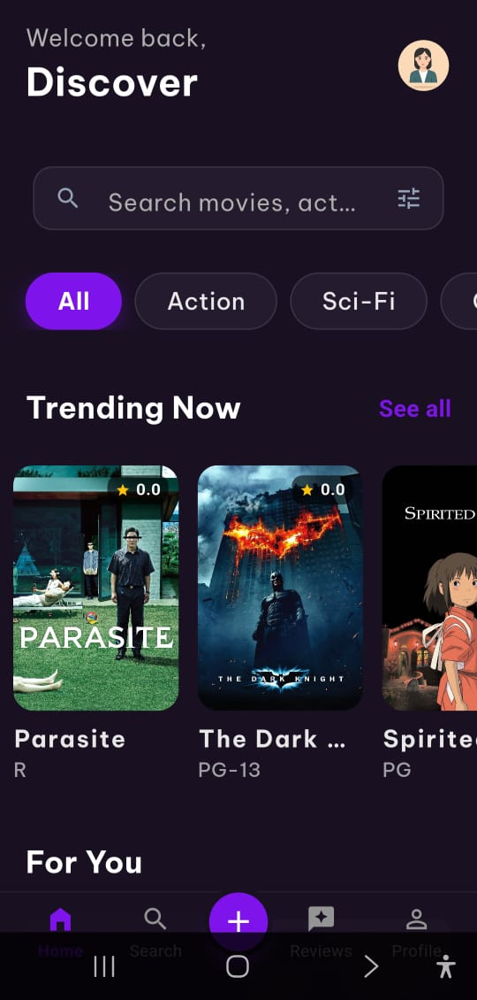
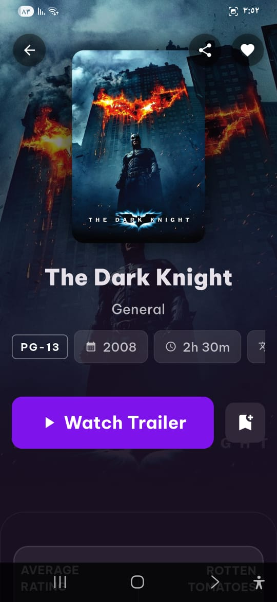

# Filmology – Movie Discovery & Review Mobile Application (Flutter)

**Filmology** is a modern, dark-themed cross-platform mobile application built with **Flutter** and **Dart** for discovering trending films, watching trailers, and sharing user reviews. Engineered using **Feature-First Clean Architecture**, **SOLID principles**, and **BLoC/Cubit** state management.

---

## Key Features

- **Movie Discovery & Search:** Browse trending and recommended movies with dynamic genre filtering (`Action`, `Sci-Fi`, etc.) and real-time search.
- **Rich Movie Details & Trailers:** View film synopses, Rotten Tomatoes & community ratings, cast profiles, and stream official movie trailers in-app.
- **Interactive Reviews & Ratings (CRUD):** Authenticated users can post, edit, delete, and rate movie reviews in real time.
- **Secure Networking & Routing:** Custom API consumer layer with `auth_interceptor`, dependency injection (`di`), and centralized declarative routing (`app_router`).

---

## Tech Stack & Architecture

- **Framework & Language:** Flutter, Dart
- **Architecture:** Feature-First Clean Architecture (`data`, `domain`, `presentation`), SOLID Principles
- **State Management & DI:** BLoC / Cubit, Dependency Injection
- **Networking & Media:** RESTful API Integration with Auth Interceptors, In-App Video Trailer Player

---

## Screenshots

| Discover & Categories | Movie Details & Trailer | Cast & User Reviews |
| :---: | :---: | :---: |
|  |  | .jpeg) |

---

## Getting Started

1. **Clone the repository:**
   ```bash
git clone [https://github.com/aylasrhan/filmology.git](https://github.com/aylasrhan/filmology.git)
